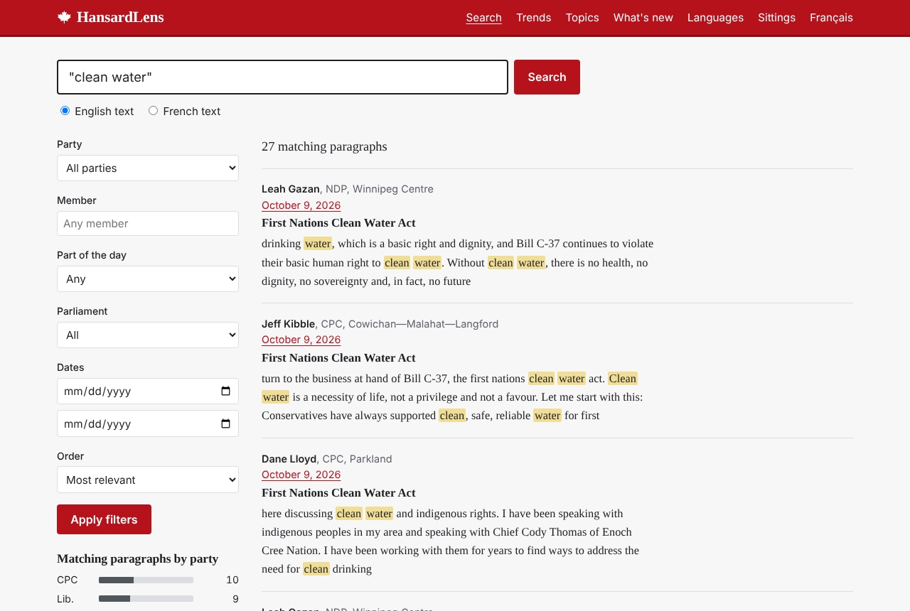
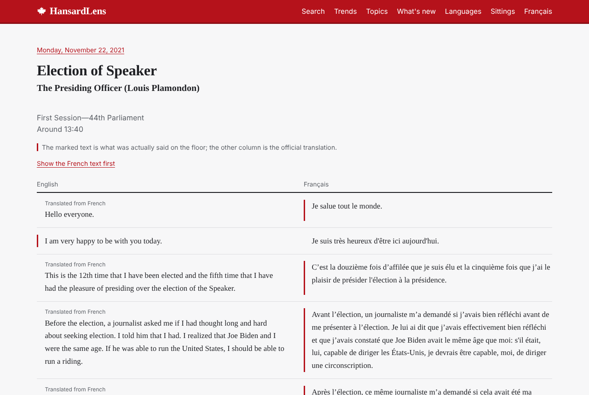
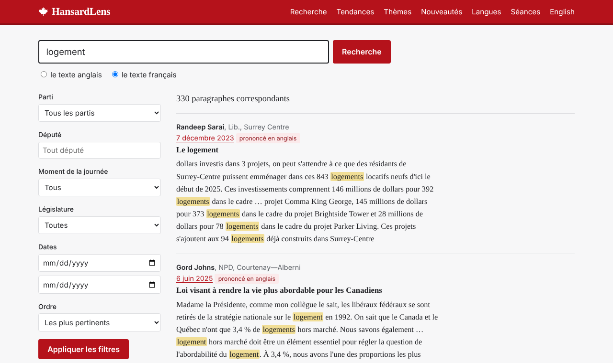

# HansardLens

Search and analyse the debates of the House of Commons of Canada in English and French.

HansardLens loads the official Hansard every sitting day, pairs every paragraph with
its translation, and records which language was actually spoken on the floor. On top of
that record it offers bilingual full-text search, a side-by-side reading view, term
trends, the share of debate held in French, topics found by NMF, and the words rising
or fading in recent debate. Everything is available through a documented REST API.
Every figure is a descriptive share with a stated denominator.

**Live site:** http://103.99.176.180/hansardlens/ (English and French, updated every
sitting day). **API docs:** http://103.99.176.180/hansardlens/api/docs/



| Bilingual reading view | French interface |
| ---------------------- | ---------------- |
|  |  |

*Screenshots from a development database with a sample of sittings.*

## Features

- **Search** either language at paragraph level: accent-insensitive with stemming,
  `"exact phrases"`, `OR` and `-exclude`, with filters for party, member, part of the
  sitting day, Parliament and dates.
- **Read** any speech with English and French side by side; the column marked in red
  is what was actually said, the other is the official translation.
- **Trends:** compare up to four terms month by month, per 1,000 speech paragraphs.
- **Languages:** share of speech given in French, overall, by month, party and member,
  measured with one yardstick for both languages.
- **Topics:** 30 topics from TF-IDF and NMF, with each topic's share over time and
  within each party's own speeches.
- **What's new:** terms rising or fading in the last 60 days of sittings compared with the
  year before (log-odds ratio with an informative prior).
- **Bilingual interface** throughout, with House terminology, French dates and ordinals.
- **REST API** under `/api/v1/` with interactive OpenAPI docs.

How each number is computed, and its limits: **[docs/METHODS.md](docs/METHODS.md)**.
How the code is organised: **[docs/ARCHITECTURE.md](docs/ARCHITECTURE.md)**.

## Stack

Python 3.12 · Django 5.2 LTS · PostgreSQL 16 (full-text search, generated columns) ·
scikit-learn · Django REST Framework + drf-spectacular · WhiteNoise · gunicorn ·
Docker Compose · pytest · Ruff · GitHub Actions

## Quick start

```bash
cp .env.example .env
docker compose up -d --build

# Load the 44th and 45th Parliaments (about an hour; downloads are cached in data/raw)
docker compose run --rm web python manage.py load_hansard --parliament 44 --session 1
docker compose run --rm web python manage.py load_hansard --parliament 45 --session 1

# Build the analysis (a few minutes)
docker compose run --rm web python manage.py build_topics
docker compose run --rm web python manage.py build_term_shifts

# Check the data
docker compose run --rm web python manage.py hansard_quality
```

Open http://localhost:8000/ (or http://localhost:8000/?lang=fr for French).

| Page | Address |
| ---- | ------- |
| Search | `/search/` |
| Trends | `/trends/` |
| Topics | `/topics/` |
| What's new | `/new/` |
| Languages | `/language/` |
| Sittings | `/sittings/`, `/sittings/44-1/50/` |
| A speech | `/speeches/<House id>/` |
| API docs | `/api/docs/` |
| Health check | `/health/` |

`?lang=en|fr` sets the interface language (remembered in a cookie); `?text=en|fr` sets
which text is searched or shown first, so the French interface can search the English
record and the reverse.

## API

Read-only, anonymous, rate-limited (120 requests per minute by default, `API_RATE`),
paginated (`page`, `page_size` up to 200). Interactive docs at `/api/docs/`, OpenAPI
schema at `/api/schema/`.

| Endpoint | Returns |
| -------- | ------- |
| `GET /api/v1/sittings/` | Sittings, newest first; filters `parliament`, `session`, `date_from`, `date_to` |
| `GET /api/v1/sittings/44-1/50/` | One sitting with every intervention |
| `GET /api/v1/speeches/{house_id}/` | One speech, every paragraph in English and French with its floor language |
| `GET /api/v1/people/` | Speakers with latest party and riding |
| `GET /api/v1/search/?q=…&text=en` | Paragraph search with highlighted snippets |
| `GET /api/v1/trends/?term=a&term=b` | Mentions per 1,000 paragraphs by month |
| `GET /api/v1/language/` | French share overall, by month, party and member |
| `GET /api/v1/topics/`, `/api/v1/topics/{n}/` | Topic model; one topic's shares over time and by party |
| `GET /api/v1/term-shifts/` | Latest rising and fading terms |

## Keeping it current

Both Docker stacks include a `scheduler` service that runs `refresh_data` Tuesday to
Saturday at 06:30, after the House publishes the previous day's Hansard. It catches up
when the computer was asleep or off at that time, retries hourly after a failure, and
reports its last run on `/health/` and in `docker compose logs scheduler`.

`refresh_data` loads new sittings, follows a new session or Parliament when the current
one ends, rebuilds term shifts when anything new arrived and refits topics weekly. Run it
by hand at any time:

```bash
docker compose run --rm web python manage.py refresh_data
```

## Production

```bash
cp .env.example .env    # set DJANGO_SECRET_KEY, DJANGO_ALLOWED_HOSTS, POSTGRES_PASSWORD
docker compose -f docker-compose.prod.yml up -d --build
```

The production stack listens on `127.0.0.1:8010` for a reverse proxy, and can be served
under a sub-path (`DJANGO_SCRIPT_NAME`) next to other apps on the same server: see
**[deploy/DEPLOY.md](deploy/DEPLOY.md)**.

- gunicorn, `DEBUG` off; refuses to start with the development secret key.
- Hashed, compressed static files served by WhiteNoise.
- Security headers (`X-Frame-Options: DENY`, `nosniff`, same-origin referrer and opener
  policies); `DJANGO_HTTPS=1` adds secure cookies, HSTS and an HTTPS redirect.
- Shared file cache for analysis results and API rate limits; cache keys include the
  latest load time, so new data refreshes every figure.
- Non-root container with a health check on `/health/`, which also reports the last
  refresh and the newest backup.
- Nightly database backups with retention and a tested restore procedure; optional
  email alerts when the refresh or a backup fails (see deploy/DEPLOY.md).

## Development

```bash
docker compose run --rm web pytest -q            # 154 tests, against PostgreSQL
docker compose run --rm web ruff check .
docker compose run --rm web ruff format --check .
```

GitHub Actions runs the same checks on every push and pull request.

### Updating dependencies

`requirements.in` and `requirements-dev.in` list the version ranges the project accepts.
`requirements.txt` and `requirements-dev.txt` are generated from them with exact
versions and checksums, so every build installs the same packages. Dependabot proposes
updates weekly as pull requests, which CI tests before you merge. To regenerate by hand:

```bash
pip install pip-tools
pip-compile --generate-hashes --strip-extras --allow-unsafe -o requirements.txt requirements.in
pip-compile --generate-hashes --strip-extras --allow-unsafe -o requirements-dev.txt requirements-dev.in
```

### Translations

Interface translations live in `locale/fr/LC_MESSAGES/`. After changing interface text:

```bash
docker compose run --rm web python manage.py makemessages -l fr
# translate the new entries in django.po, then
docker compose run --rm web python manage.py compilemessages
```

```
config/                 settings, URLs
debates/
  hansard_xml.py        fetch and inspect House XML
  parsing.py            XML -> records; English/French merge
  speakers.py           speaker labels
  loader.py             cache, store, backfill
  search.py             full-text search
  analysis.py           trends and language shares
  textmine.py           topics and term shifts
  api.py                REST API
  management/commands/  load_hansard, refresh_data, build_topics, ...
  tests/                pytest suite and invented fixtures
templates/, static/     pages, CSS, chart script
locale/fr/              French interface
docs/                   methods, architecture, screenshots
```

## Data source and terms

Debate text comes from the [House of Commons of Canada](https://www.ourcommons.ca/en/open-data)
and is reproduced under the
[Speaker's permission](https://www.ourcommons.ca/en/important-notices), which allows
reproduction provided it is accurate, is not presented as official, and is not for
commercial use. HansardLens is not an official publication of the House of Commons. Its
text is reproduced as published (whitespace normalized; recorded-vote name lists left
out of speech text).

This repository contains code only: Hansard files are downloaded at run time into
`data/` and are never committed. The test fixtures are invented text in the same XML
structure.

## Licence

Code: MIT (see [LICENSE](LICENSE)). Debate text: see above.
