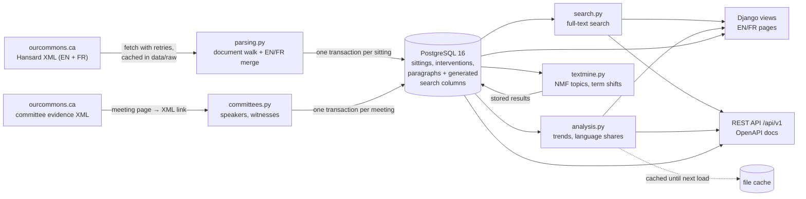
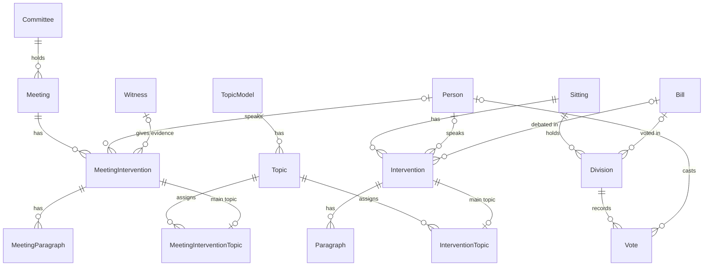

# HansardLens architecture

## Data flow

## Components

| Path | Responsibility |
| ---- | -------------- |
| `debates/hansard_xml.py` | URL pattern, polite fetch with retries (2, 4, 8 s), structure report |
| `debates/parsing.py` | Walk one XML document in order (agenda, time and floor language as running state); merge English and French |
| `debates/speakers.py` | Parse speaker labels: name, honorific, riding, role, party, chair occupants |
| `debates/loader.py` | Cache, download, store a sitting atomically, backfill parties |
| `debates/search.py` | Query parsing, filters, ranking, safe highlighted snippets |
| `debates/analysis.py` | Monthly term rates, language shares, topic shares, member profiles; cached by data version |
| `debates/textmine.py` | TF-IDF + NMF topics; log-odds term shifts |
| `debates/bills.py` | Find bills from the motions that move them; link debates, stages and votes |
| `debates/committees.py` | Find a committee meeting's evidence XML, read speaker roles, store meetings and witnesses |
| `debates/witness_kinds.py` | Kind of each witness (federal, business, union, …) from the printed title and organisation |
| `debates/committee_analysis.py` | Who is heard, committee topics with the House model, French in committee, members' committee work; cached |
| `debates/committee_views.py` | Committee, meeting, witness and committee search pages |
| `debates/kinds.py` | Statements, questions and answers the House typed "Debate", from the part of the sitting day |
| `debates/votes.py` | Store recorded votes, match printed names to members, mark party lines |
| `debates/api.py` | Read-only DRF endpoints and OpenAPI schema |
| `debates/middleware.py` | Interface language from `?lang=`, remembered in a cookie |
| `debates/templatetags/hansard.py` | Locale-aware dates, ordinals, party abbreviations |
| `static/js/linechart.js` | Dependency-free SVG line chart with keyboard crosshair |

## Data model

- `Paragraph.search_en`, `search_fr` and `words_en` are PostgreSQL generated columns,
  so a load never needs a separate indexing step.
- A sitting is replaced as a whole in one transaction, so reloading is idempotent.
- Speeches are addressed by the House's own id (`/speeches/12601257/`), sittings by
  number (`/sittings/44-1/50/`) and members by a name-based slug set once
  (`/members/bernard-genereux/`), so links survive reloads. Committee meetings are
  addressed by committee, session and number (`/committees/FINA/44-1/100/`) and
  witnesses by a slug set once from the House's witness id.

## Commands

| Command | Purpose |
| ------- | ------- |
| `inspect_sitting` | Download one sitting and report its XML structure |
| `load_hansard` | Load a range of sittings, or continue to the latest |
| `hansard_quality` | Data-quality report |
| `build_topics` | Fit the topic model |
| `build_term_shifts` | Compute rising and fading terms |
| `build_bills` | Find bills and link them to their debates and recorded votes |
| `load_divisions` | Add recorded votes to sittings loaded before version 1.5 |
| `load_committees` | Load the public meetings of the chosen committees, continuing from the last one loaded |
| `refresh_data` | Daily: load new sittings (following a new session or Parliament) and committee meetings, then update the analysis and bills |

## Testing

- 370 tests with pytest against PostgreSQL (CI uses a PostgreSQL service).
- The parser is tested on invented XML with the real structure (real Hansard text is
  never committed), and on real sittings when they have been downloaded locally.
- The ingestion commands are tested against a fake House website: missing sittings,
  network failures, missing French versions, new sessions and new Parliaments; the
  committee loader against meetings in camera and meeting numbers that do not exist.
- The text-mining methods are tested on a synthetic corpus with two known subjects,
  including committee speeches scored with the House topics.
- The witness classifier is tested on real committee labels of every kind.
